<!-- HEADER WAVE CON DEGRADADO (AI ENGINEER AL FINAL) -->

<!-- BOTONES SUPERIORES MINIMALISTAS -->

  

<!-- TERMINAL MACOS PERSONALIZADA (SVG ANIMADO PROPIO · TOKYONIGHT) -->

  

<!-- SUBTÍTULO MECANOGRAFIADO MULTICOLOR -->

<!-- CONSOLA LINUX (SVG ANIMADO PROPIO · perfil, proyectos, idiomas y stack) -->

  

 

<b>📄 Versión en texto</b> (accesible y copiable)

### ❯ Profile & Background

- **Educación:** Máster en IA & Big Data Analytics (ETSIIT - UPV) y Graduado en Tecnología Digital y Multimedia (**GTDM** - UPV).
- **Enfoque técnico:** Desarrollo Full-Stack, Machine Learning con **PyTorch** y creación de productos digitales interactivos.
- **Metodología:** Ingeniería acelerada por IA integrando **Claude Code** a diario para refactorización, arquitectura y optimización.
- **Objetivo:** Multimedia Technologist y Creador de Contenido formándome como **AI Engineer**.

---

### ✦ Proyectos y Trayectoria

- **`inazudle.com`** — Aplicación web interactiva desarrollada y desplegada en producción a escala real con base de usuarios activa.
- **`byRaspy` (YouTube, +50.000 subs)** — Más de 7 años de creación audiovisual, edición avanzada, storytelling y motion graphics.
- **`neestoor7/motion`** — Herramienta generativa para automatizar motion graphics y piezas verticales a partir de pistas de audio.
- **Optimización & Growth** — 4 años de experiencia en SEO técnico, analítica digital, arquitectura web y Meta Ads.

---

### 🌐 Idiomas & Certificaciones

- **Inglés:** **C1 Advanced** — Cambridge Certificate (Valencia)
- **Valenciano:** **C1** — Certificado Oficial JQCV
- **Japonés:** Actualmente en formación continua

---

### 🛠️ Tech Stack & Herramientas

| Área | Tecnologías Clave |
| :--- | :--- |
| **Machine Learning & Datos** | Python, PyTorch, Scikit-Learn, MongoDB, SQL |
| **Desarrollo & Frontend** | JavaScript, React, TypeScript, C++, Java, R, HTML5, CSS3, Bash |
| **Cloud, DevOps & Entornos** | Docker, Git, GitHub Actions, AWS, Azure, Claude Code, Linux, macOS |
| **Audiovisual & Motion** | Premiere Pro, After Effects, Figma, Motion Design Generativo |

---

<!-- ENLACES DE CONTACTO -->

  

<!-- ONDA INFERIOR -->

